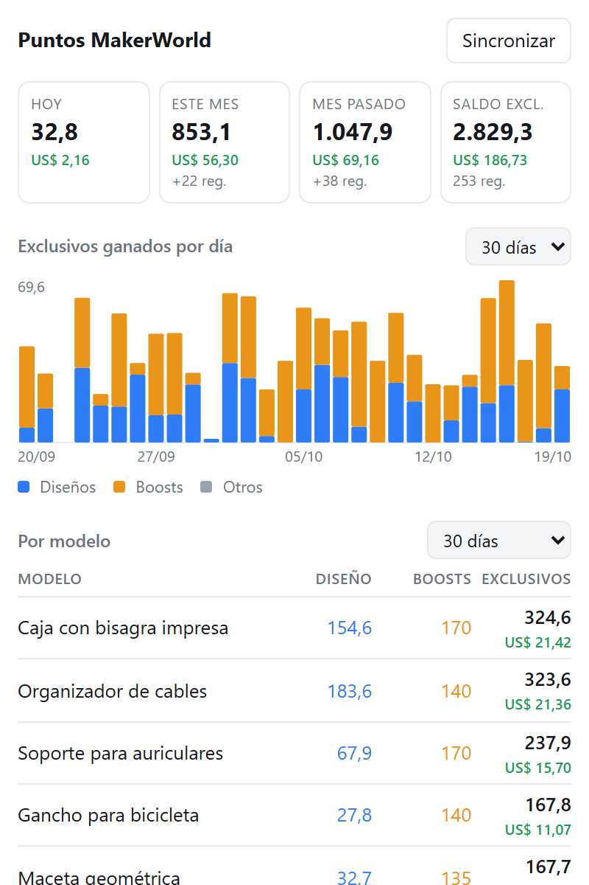
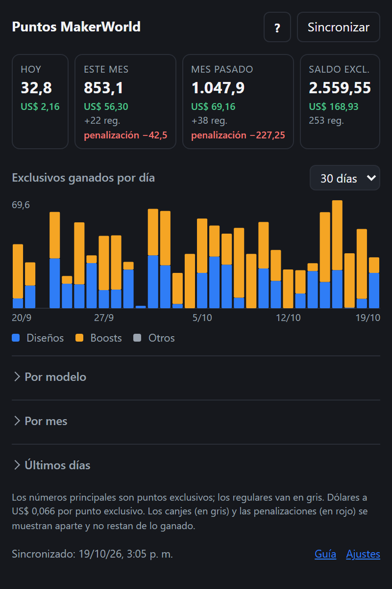
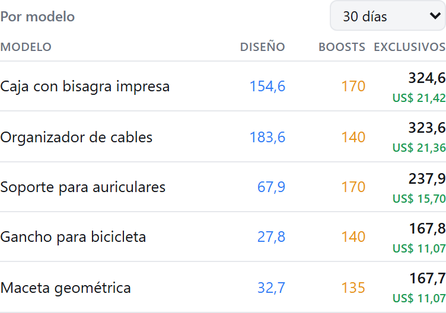
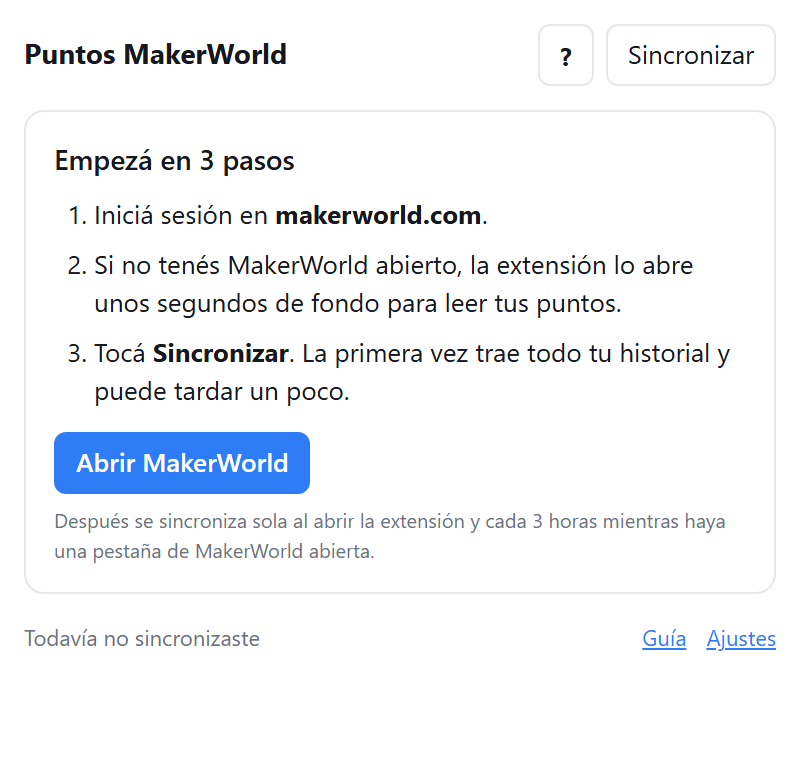
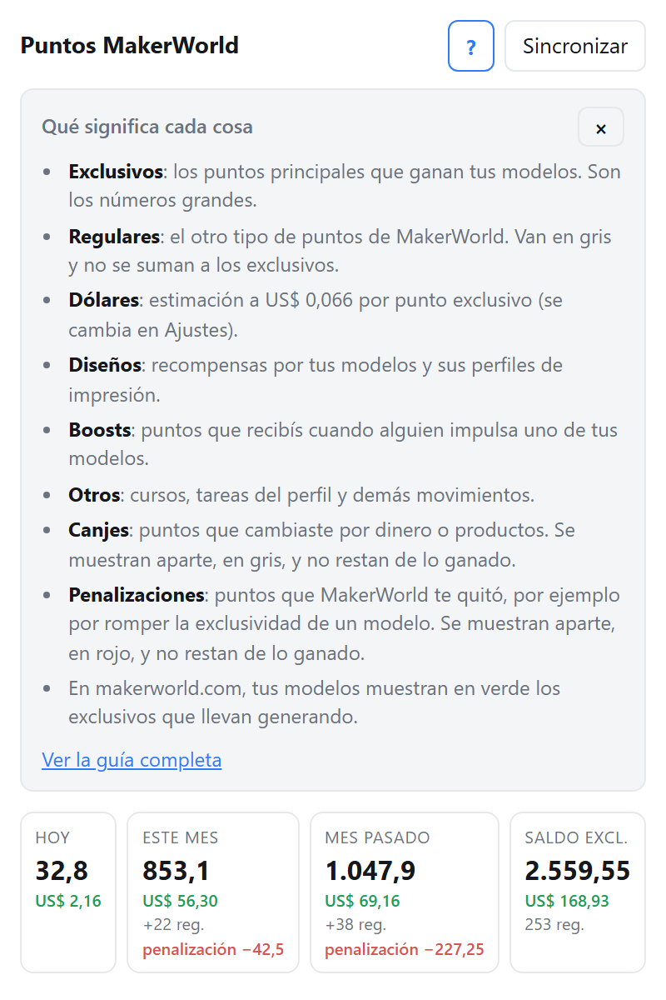
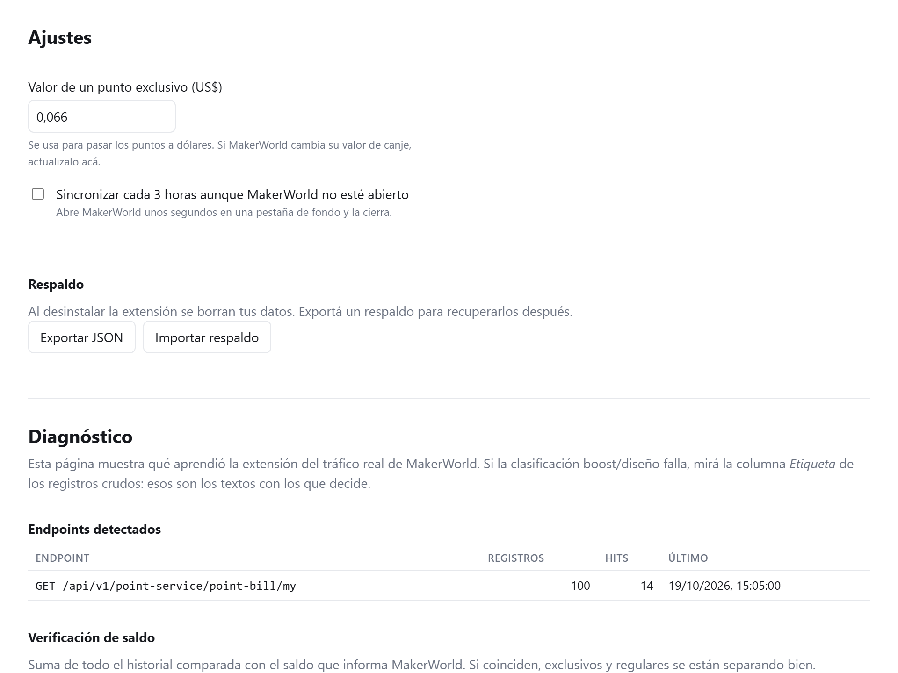

# MakerWorld Points Tracker

Extensión de Chrome (Manifest V3) que lleva el control de los puntos que ganás en
MakerWorld, con foco en los **puntos exclusivos** y su valor en dólares, separando
cuánto viene de **diseños** y cuánto de **boosts**.

<p align="center">
  
  &nbsp;
  
</p>

<sub>Capturas con un historial de ejemplo inventado. El popup sigue el tema claro u
oscuro del sistema.</sub>

## Qué muestra

- **Hoy, este mes, mes pasado y saldo** en puntos exclusivos, con su valor en
  dólares (US$ 0,066 por punto) y los regulares en segundo plano.
- **Gráfico diario** de exclusivos ganados (14, 30 o 90 días), apilado por diseños,
  boosts y otros.
- **Por modelo**: cuántos exclusivos (y dólares) dio cada modelo en el período
  elegido (este mes, mes pasado, 30 o 90 días, o todo), separando recompensas de
  diseño y perfiles de impresión de boosts. Muestra los 10 que más dieron y el resto
  a pedido.
- **Tabla por mes** y **últimos días**. Los canjes se muestran aparte y no restan de
  lo ganado.

<p align="center">
  
</p>

Los modelos se agrupan por id si el historial lo trae y, si no, por título: un
modelo al que le cambiaste el nombre puede aparecer dos veces.

### En las tarjetas de MakerWorld

En makerworld.com, cada tarjeta de un modelo tuyo que haya dado puntos muestra, al
lado de likes, descargas e impresiones, los exclusivos que lleva generando (en
verde). En la página del modelo aparece en la fila de boosts, descargas e
impresiones, antes de la fecha de publicación. Pasando el mouse se ven los dólares, el desglose diseño / boosts y los
últimos 30 días. Lo hace [`src/cards.js`](src/cards.js), que busca la tarjeta por el
link `/models/<id>` y su título original, y se actualiza solo al sincronizar.

## Cómo obtiene los datos

MakerWorld no tiene API pública y su WAF rechaza requests hechas desde fuera del
navegador, así que todo sale desde una pestaña de makerworld.com con tu sesión:

1. **Historial de movimientos** — `/api/v1/point-service/point-bill/my`, paginado de
   a 100. Cada movimiento trae `type`, `createTime`, `pointChangeExclusive` y
   `pointChangeRegular`. La primera sincronización lo recorre entero; las siguientes
   solo traen lo nuevo. Ver [`src/lib/bills.js`](src/lib/bills.js).
2. **Saldo actual** — de `__NEXT_DATA__` de la página `/points`
   (`boostAndPointSummary`). Ver [`src/lib/snapshot.js`](src/lib/snapshot.js).

`src/sniffer.js` corre en el mundo `MAIN` de la página y ejecuta esas requests
cuando el service worker se lo pide; `src/bridge.js` hace de puente.

### Clasificación

| Tipo de MakerWorld | Categoría |
| --- | --- |
| `boost_exchange_point` | Boosts |
| `design_reward*`, `instance_reward*`, `upload_model` | Diseños |
| resto (canjes, cursos, perfil…) | Otros |

## Instalación

Desde la Chrome Web Store (cuando esté publicada), o para desarrollo:

```
chrome://extensions → Modo desarrollador → Cargar descomprimida → esta carpeta
```

## Uso

Al instalarla se abre una guía de bienvenida con los pasos:

1. Iniciá sesión en makerworld.com.
2. Fijá la extensión en la barra de Chrome.
3. Abrí el popup y tocá **Sincronizar**.

No hace falta tener MakerWorld abierto: si no hay una pestaña que sirva (ninguna,
suspendida o abierta antes de instalar la extensión), al sincronizar se abre una de
fondo unos segundos y se cierra. MakerWorld solo acepta las consultas hechas desde su
propia página, por eso no se puede sincronizar sin una pestaña.

Además se sincroniza sola:

- al abrir el popup, si pasó más de una hora y hay una pestaña de MakerWorld abierta;
- cada 3 horas, si hay una pestaña de MakerWorld abierta. En Ajustes se puede activar
  que lo haga aunque no la haya, abriendo una de fondo.

Hasta la primera sincronización, el popup muestra los pasos en lugar de tablas vacías.
Los errores traen un botón para resolverlos (abrir MakerWorld, recargar la pestaña).
El botón **?** explica qué significa cada número, y *Guía* vuelve a abrir la bienvenida.

<p align="center">
  
  &nbsp;
  
</p>

### Avisos

- **El historial no cierra con el saldo**: si la suma de todos los movimientos difiere
  del saldo que informa MakerWorld, el popup avisa (puede faltar algún movimiento). Se
  puede silenciar para esa diferencia; si cambia, vuelve a avisar.
- **MakerWorld cambió algo**: si la API de puntos responde con otra forma, la
  sincronización falla con un mensaje claro en lugar de guardar datos equivocados, y el
  popup lo recuerda hasta la próxima sincronización buena.

## Idiomas

Castellano e inglés, según el idioma del navegador (inglés si no es castellano).
Los textos están en `_locales/<idioma>/messages.json`; las páginas los toman con
`src/lib/i18n.js` (atributos `data-i18n*` en el HTML y `t()` en el código). En los
mensajes, `$1`…`$9` son sustituciones y un `$` literal va como `$$`.

## Ajustes y diagnóstico

Popup → *Ajustes*:

- **Valor de un punto exclusivo** en dólares (0,066 por defecto), para el popup, la
  guía y las tarjetas de makerworld.com.
- **Sincronizar cada 3 horas aunque MakerWorld no esté abierto.**
- **Respaldo**: exportar todo a JSON e importarlo después (por ejemplo, tras
  reinstalar). Importar suma los movimientos que falten; no borra nada.
- **Diagnóstico**: verificación de la suma del historial contra el saldo real,
  clasificación por tipo de movimiento, endpoints vistos y exportación a CSV.



## Datos

Todo queda local en `chrome.storage.local`. No sale nada hacia ningún servidor. Ver
[PRIVACY.md](PRIVACY.md), que es la política que se enlaza desde la Chrome Web Store.

El formato guardado tiene versión (`meta.schema`, ver `SCHEMA` y `migrate` en
[`src/lib/store.js`](src/lib/store.js)). Si una versión cambia la forma de los datos,
sube `SCHEMA` y agrega el paso de migración, así nadie pierde su historial al
actualizar.

## Tests

```
npm test
```

Corre los tests de parseo y los de traducciones (mismas claves en castellano e
inglés, mismas sustituciones, ningún `$` suelto, todas las claves usadas existen y
nombre y descripción dentro de los límites de la tienda). GitHub Actions los corre en
cada PR y en `main` ([`.github/workflows/ci.yml`](.github/workflows/ci.yml)).

## Publicar una versión

1. Subí la versión en `manifest.json` y `package.json` (tienen que coincidir).
2. `npm run empaquetar` arma `dist/points-tracker-<versión>.zip` solo con lo que usa
   la extensión.
3. Al subir un tag `v<versión>` (por ejemplo `git tag v1.0.0 && git push --tags`),
   [`release.yml`](.github/workflows/release.yml) corre los tests, arma el ZIP y crea
   un release de GitHub con el ZIP adjunto.
4. Ese ZIP se sube en el [panel de la Chrome Web Store](https://chrome.google.com/webstore/devconsole).

Las imágenes para la ficha de la tienda (capturas de 1280×800 e imagen promocional de
440×280, en castellano e inglés) están en `docs/tienda/<idioma>/`.

## Capturas

Las imágenes de este README y de la tienda salen de `scripts/capturas.mjs`, que abre
el popup, la guía y los ajustes en Chromium con un `chrome` simulado y un historial de
ejemplo (nunca datos de una cuenta real):

```
npm install
npx playwright install chromium
npm run capturas
```

Escribe `docs/capturas/*.png` y `docs/tienda/es/`; con `LANG_CAPTURAS=en`, la versión
en inglés en `docs/capturas/en/` y `docs/tienda/en/`. Cualquier cambio visible en el
popup, la guía o los ajustes debería venir con las capturas regeneradas.
