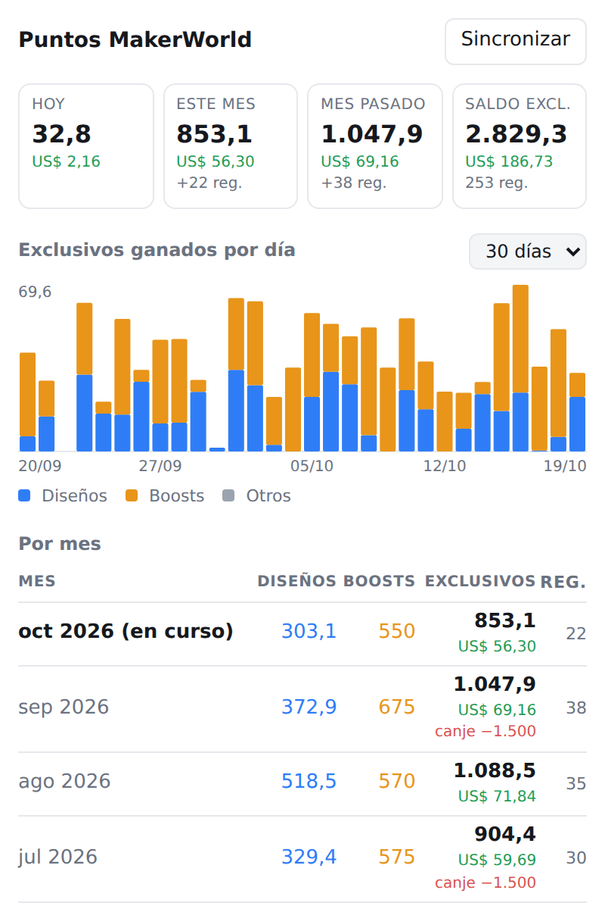
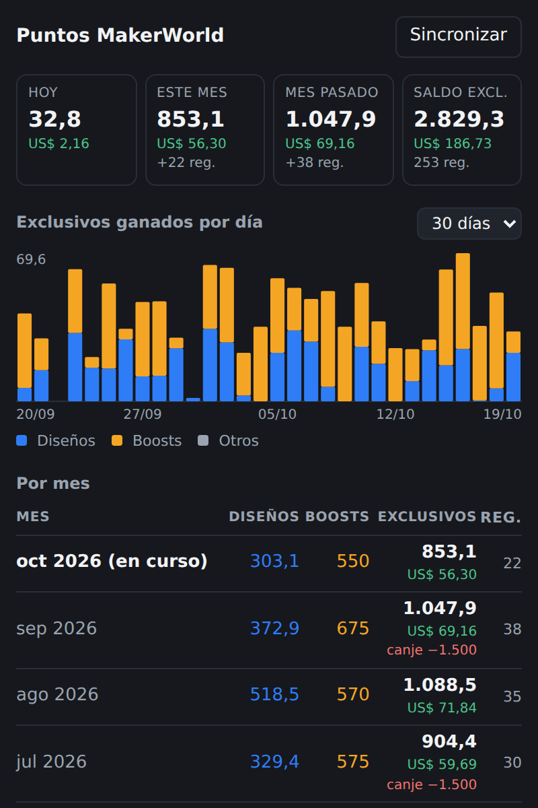
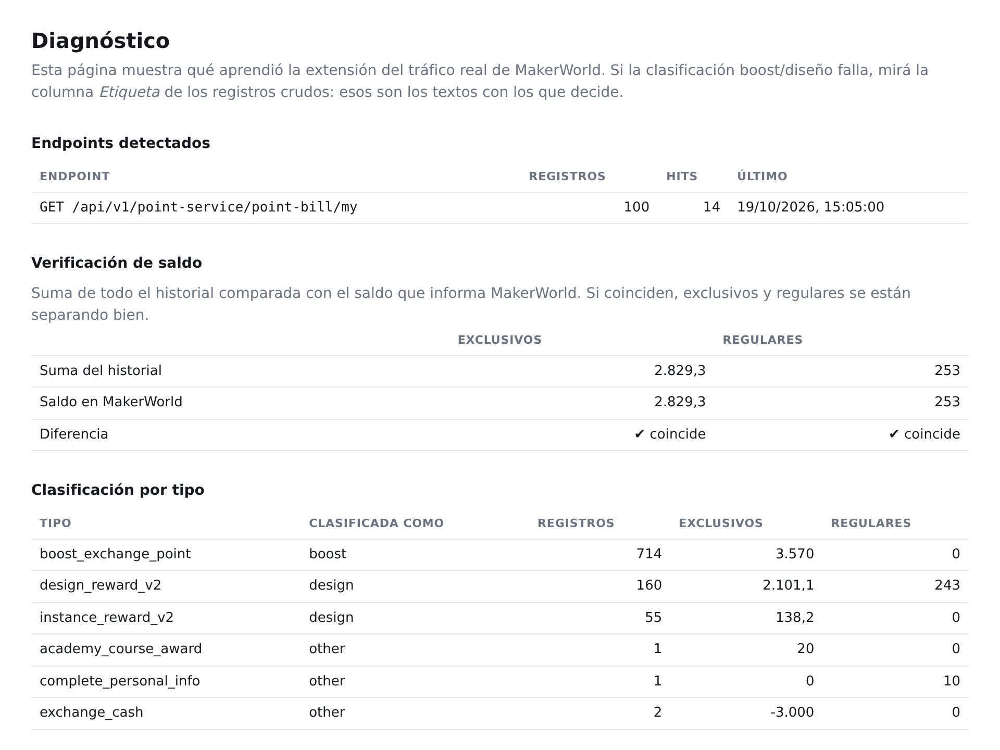

# MakerWorld Points Tracker

Extensión de Chrome (Manifest V3) que lleva el control de los puntos que ganás en
MakerWorld, con foco en los **puntos exclusivos** y su valor en dólares, separando
cuánto viene de **diseños** y cuánto de **boosts**.

<p align="center">
  
  &nbsp;
  
</p>

<sub>Capturas con un historial de ejemplo inventado. El popup sigue el tema claro u
oscuro del sistema.</sub>

## Qué muestra

- **Hoy, este mes, mes pasado y saldo** en puntos exclusivos, con su valor en
  dólares (US$ 0,066 por punto) y los regulares en segundo plano.
- **Gráfico diario** de exclusivos ganados (14, 30 o 90 días), apilado por diseños,
  boosts y otros.
- **Tabla por mes** y **últimos días**. Los canjes se muestran aparte y no restan de
  lo ganado.

## Cómo obtiene los datos

MakerWorld no tiene API pública y su WAF rechaza requests hechas desde fuera del
navegador, así que todo sale desde una pestaña de makerworld.com con tu sesión:

1. **Historial de movimientos** — `/api/v1/point-service/point-bill/my`, paginado de
   a 100. Cada movimiento trae `type`, `createTime`, `pointChangeExclusive` y
   `pointChangeRegular`. La primera sincronización lo recorre entero; las siguientes
   solo traen lo nuevo. Ver [`src/lib/bills.js`](src/lib/bills.js).
2. **Saldo actual** — de `__NEXT_DATA__` de la página `/points`
   (`boostAndPointSummary`). Ver [`src/lib/snapshot.js`](src/lib/snapshot.js).

`src/sniffer.js` corre en el mundo `MAIN` de la página y ejecuta esas requests
cuando el service worker se lo pide; `src/bridge.js` hace de puente.

### Clasificación

| Tipo de MakerWorld | Categoría |
| --- | --- |
| `boost_exchange_point` | Boosts |
| `design_reward*`, `instance_reward*`, `upload_model` | Diseños |
| resto (canjes, cursos, perfil…) | Otros |

## Instalación

```
chrome://extensions → Modo desarrollador → Cargar descomprimida → esta carpeta
```

## Uso

1. Iniciá sesión en makerworld.com y dejá una pestaña abierta.
2. Abrí el popup y tocá **Sincronizar**.

Se sincroniza sola cada 3 horas mientras haya una pestaña de MakerWorld abierta.

## Diagnóstico

Popup → *Diagnóstico*: verificación de la suma del historial contra el saldo real,
clasificación por tipo de movimiento, endpoints vistos y exportación a JSON o CSV.



## Datos

Todo queda local en `chrome.storage.local`. No sale nada hacia ningún servidor.

## Tests

```
npm test
```

## Capturas

Las imágenes de este README salen de `scripts/capturas.mjs`, que abre el popup y la
página de diagnóstico en Chromium con un `chrome` simulado y un historial de ejemplo
(nunca datos de una cuenta real):

```
npm install
npx playwright install chromium
npm run capturas
```

Escribe `docs/capturas/*.png`. Cualquier cambio visible en el popup o el diagnóstico
debería venir con las capturas regeneradas.
